# Artifact Portfolio & Empirical Compendium: Unified Streaming Vision Architecture

**Project Title:** Unified Streaming Vision Architecture: Structural Co-Design of Line-Buffered ISP and Early Convolutional Feature Stem with Autonomous Sensor Feedback  
**Student Author:** Maneesh S. Kolekar (Indian Institute of Technology Guwahati)  
**Primary Reference Paper:** [`paper/btp_report.pdf`](file:///Users/maneeshskolekar/btp/paper/btp_report.pdf) (8-Page IEEE Conference Paper)  
**Verification Target:** Capstone Evaluation Panel (Quantitative Telemetry, Architectural Assets & Empirical Data)

---

## 1. Master Quantitative Telemetry Matrix

Single-view comparison of the proposed streaming architecture against state-of-the-art edge vision baselines across 8,163 real factory inspection photographs.

| Architecture / Model | Params | INT8 Footprint | DRAM Bandwidth | Line Buffer SRAM | Flight Latency | Accuracy | Escape Rate (FNR) | Overkill Rate (FPR) | Micro-Crack Recall (<3px) | Frame Drops ($P_{\text{drop}}$) |
| :--- | :---: | :---: | :---: | :---: | :---: | :---: | :---: | :---: | :---: | :---: |
| **SmallNet-v3 (Proposed)** | **15,043** | **14.69 KB** | **0.0 GB/s** | **< 5 KB** | **34.50 $\mu$s** | **97.63%** | **2.87%** | **1.78%** | **82.35%** | **0.0%** |
| SmallNet-v2 (Dual Pool) | 13,986 | 13.66 KB | 0.0 GB/s | < 5 KB | 34.50 $\mu$s | 97.24% | 2.90% | 2.15% | 76.47% | 0.0% |
| **PhiNet-15K** (*ACM TECS '22*) | 15,120 | 14.76 KB | 1.20 GB/s | Frame-Buffered | 16,700 $\mu$s | 96.41% | 3.77% | 3.39% | 47.06% | > 1.2% |
| PhiNet-31K (*Default*) | 30,995 | 30.27 KB | 1.20 GB/s | Frame-Buffered | 16,700 $\mu$s | 94.28% | 7.09% | 4.10% | 52.94% | > 1.2% |
| MobileNetV2 (Linear RGB) | 2.22 M | 2,174 KB | 1.20 GB/s | Frame-Buffered | 18,200 $\mu$s | 98.94% | 1.66% | 0.36% | 88.24% | > 1.5% |
| MobileNetV2 (sRGB Baseline) | 2.22 M | 2,174 KB | 1.20 GB/s | Frame-Buffered | 18,200 $\mu$s | 98.61% | 2.11% | 0.53% | 70.59% | > 1.5% |
| ResNet-18 (Heavyweight) | 11.17 M | 10,915 KB | 3.80 GB/s | Frame-Buffered | 35,400 $\mu$s | 98.69% | 2.11% | 0.36% | 76.47% | > 3.0% |
| Otsu Morphological Baseline | 8 | < 0.1 KB | 0.0 GB/s | 2.4 KB | 20.00 $\mu$s | 49.59% | 87.63% | 6.42% | 17.65% | 0.0% |
| Mahalanobis Linear Baseline | 1,368 | 1.34 KB | 0.0 GB/s | 2.4 KB | 20.00 $\mu$s | 78.02% | 39.37% | 1.43% | 11.76% | 0.0% |

---

## 2. Dataset Registry & Ingestion Specifications

All empirical evaluations strictly utilize 0% synthetic data across 8,163 photographic captures of real manufactured parts.

```
+---------------------------------------------------------------------------------------------------------+
|                                    INDUSTRIAL DATASET SPECIFICATIONS                                    |
+----------------------+--------------------+--------+--------------------+-------------------------------+
| Dataset Suite        | Direct Source URL  | Images | Target Geometry    | Defect Modalities             |
+----------------------+--------------------+--------+--------------------+-------------------------------+
| Pilot Technocast     | Kaggle Ingestion*  | 7,348  | Cast Iron Pump     | Blowholes, shrinkage cavities,|
| Casting Suite        |                    |        | Impellers          | fractures, mold inclusions    |
+----------------------+--------------------+--------+--------------------+-------------------------------+
| MVTec AD Fasteners   | MVTec Portal**     |    815 | Threaded Nuts &    | Stripped pitch, thread deform,|
| (Nuts & Screws)      |                    |        | Structural Screws  | scratches, chemical oxidation |
+----------------------+--------------------+--------+--------------------+-------------------------------+
| MVTec Out-of-Domain  | MVTec Portal**     |  6,700 | Transistor Leads,  | Bent pins, hairline breaks,   |
| (Generalization)     |                    | /domain| PCB, Pill, Zipper  | edge chips, missing teeth     |
+----------------------+--------------------+--------+--------------------+-------------------------------+
*Kaggle Source: https://www.kaggle.com/datasets/ravirajsinh45/real-life-industrial-dataset-of-casting-product
**MVTec Source: https://www.mvtec.com/company/research/datasets/mvtec-ad
```

### Optical & Ingestion Invariants
- **Physical Conveyor Clearance:** Every sample satisfies $\ge 10\text{ px}$ boundary clearance on all four borders against uniform staging background (matte black).
- **Ingestion Pipeline:** Compressed 8-bit sRGB $\to$ Inverted Tone Mapping ($I_{\text{lin}} = I^{2.4}$) $\to$ Canonical D65 Inverse Color Matrix ($\mathbf{M}_{\text{RGB}\to\text{CAM}}$) $\to$ $2\times2$ RGGB Bayer CFA Mosaic Resampling.
- **Sensor Native Dynamics:** $1080\text{p}60$ rolling shutter ($148.5\text{ MHz}$ pixel clock, $\tau_{\text{clk}} = 6.734\text{ ns}$). Active frame: $1920 \times 1080$ px; Total frame: $2200 \times 1125$ line clocks. VBI window: 45 scan lines ($666.67\ \mu\text{s}$).

---

## 3. Architecture Diagrams

### 3.1 Dataflow Paradigm: Conventional DDR-Buffered vs Proposed Streaming

```mermaid
flowchart TD
    subgraph Conventional ["Conventional Edge Vision Pipeline (Off-Chip Memory Buffered)"]
        direction LR
        C1["CMOS Sensor"] --> ISP1["ISP Core"]
        ISP1 -->|"1.2 GB/s Write"| DDR1[("Off-Chip Synchronous DDR3/4")]
        DDR1 -->|"1.2 GB/s Read"| DMA1["DMA / OS Queue (V4L2)"]
        DMA1 --> NPU1["Accelerator / Edge NPU"]
    end

    subgraph Proposed ["Proposed Bump-in-the-Wire Architecture (Zero-DRAM Streaming)"]
        direction LR
        C2["CMOS Sensor"] --> LB2["2 Circular Line Buffers (<5 KB)"]
        LB2 -->|"Physical Copper Tap"| STEM2["Shift-and-Add Stem (Zero DSP)"]
        STEM2 --> SNET2["SmallNet (14.69 KB in BRAM)"]
        SNET2 --> OUT2["Defect Strobe (VBI Pin)"]
    end
```



### 3.2 Top-Level Silicon Architecture (Nodes A, B, C, D)

```
[Standard CMOS Camera (IMX219 / OV5640)]
                 │
                 │ 10-bit Raw Bayer Stream (DVP / MIPI IP)
                 ▼
+─────────────────────────────────────────────────────────────+
| NODE A: STREAMING DIRECTIONAL DEMOSAIC CORE                 |
| - 2 Circular Dual-Port Line Buffers (< 5 KB On-Chip SRAM)   |
| - 3x3 Spatial Sliding Window Registers (P00 to P22)         |
+------------------------------+------------------------------+
                               │
                               │ Physical Copper Wire Taps (Zero SRAM Overhead)
        ┌──────────────────────┴──────────────────────┐
        ▼                                             ▼
+─────────────────────────────────────────+   +──────────────────────────────────+
| NODE B: ZERO-DSP HARDWARE FEATURE STEM  |   | DISPLAY PATH (MONITOR OUT)       |
| - Shift-and-Add Hardware Tensor:        |   | - Signed Q4.12 Fixed-Point CCM   |
|     {Y_linear, |Gx|, |Gy|, |R-G|}       |   | - Single-Cycle 256x8 Gamma LUT   |
| - Zero DSP Multipliers                  |   | - Real-Time HUD Alpha Blender    |
+-------------------+---------------------+   +----------------+-----------------+
                    │                                          │
                    │ Streaming Feature Slices (II=1)          │
                    ▼                                          ▼
+─────────────────────────────────────────+             [Direct HDMI / DVI]
| NODE C: SMALLNET ACCELERATOR CORE       |             (60 FPS with BBox)
| - 4-Stage Depthwise-Separable Pyramid   |
| - 15,043 INT8 Weights (4 BRAM36K)       |
| - Streaming Attention Pooling + GMP     |
| - Latency: 34.50 us (0.0 GB/s DRAM)     |
+-------------------+---------------------+
                    │
                    │ Saliency Statistics & Centroids
                    ▼
+─────────────────────────────────────────+
| NODE D: CLOSED-LOOP SENSOR FEEDBACK     |
| - Saliency-Weighted Auto-Exposure Accum |
| - Saturated Highlight Clipping          |
| - Hardware I2C Master (FSM in VBI)      |
+-------------------+---------------------+
                    │
                    ▼ Physical SCL/SDA Lines
         [CMOS Sensor Exposure Pins]
```

### 3.3 Parametric Circular Dual-Port Line Buffer & 3x3 Sliding Window

```
Incoming Pixel D_in(t) ──┬──────────────────────────────────────────────────────────┐
                         │                                                          │
                         ▼                                                          │
             ┌─────────────────────────┐                                            │
             │ Circular Line Buffer 0  │ (Depth = W = 1920 words, Dual-Port SRAM)   │
             │ ptr_wr = t mod W        │                                            │
             │ ptr_rd = (t+1) mod W    │                                            │
             └───────────┬─────────────┘                                            │
                         │                                                          │
                         ├────────────────────────────────────────┐                 │
                         ▼                                        │                 │
             ┌─────────────────────────┐                          │                 │
             │ Circular Line Buffer 1  │ (Depth = W = 1920 words) │                 │
             └───────────┬─────────────┘                          │                 │
                         │                                        │                 │
                         ▼                                        ▼                 ▼
                   [ Row 0 Tap ]                            [ Row 1 Tap ]     [ Row 2 Tap ]
                         │                                        │                 │
             ┌───────────┴───────────┐                ┌───────────┴───────────┐     │
             ▼           ▼           ▼                ▼           ▼           ▼     ▼
          ┌─────┐     ┌─────┐     ┌─────┐          ┌─────┐     ┌─────┐     ┌─────┐
          │ P00 │ ──> │ P01 │ ──> │ P02 │          │ P10 │ ──> │ P11 │ ──> │ P12 │ ... [P20, P21, P22]
          └─────┘     └─────┘     └─────┘          └─────┘     └─────┘     └─────┘
                 9-Pixel Spatial Sliding Window Registers (Synchronous Flip-Flops)
```

### 3.4 SmallNet-v3 4-Stage Depthwise-Separable Pyramid

```
Hardware Stem Tensor [4 x 300 x 300]
         │
         ▼
[Stage 0: Adapter]  Conv1x1 (Folded BN) + DWConv3x3 (Stride 2)  --> [16 x 150 x 150] (Line Buffer: 1.2 KB)
         │
         ▼
[Stage 1: Block 1]  DWConv3x3 (Stride 1) + PWConv1x1            --> [24 x 150 x 150] (Line Buffer: 1.2 KB)
         │
         ▼
[Stage 2: Block 2]  DWConv3x3 (Stride 2) + PWConv1x1            --> [32 x 75 x 75]   (Line Buffer: 0.6 KB)
         │
         ▼
[Stage 3: Block 3]  DWConv3x3 (Stride 2) + PWConv1x1            --> [48 x 38 x 38]   (Line Buffer: 0.3 KB)
         │
         ▼
[Stage 4: Block 4]  DWConv3x3 (Stride 2) + PWConv1x1            --> [64 x 19 x 19]   (Line Buffer: 0.15 KB)
         │
         ├──────────────────────────────────────┐
         ▼                                      ▼
[Streaming Attention Pool (1x1)]      [Global Max Pool (GMP)]
  - Softmax Spatial Saliency Weight     - 64 Comparators (Zero DSP)
  - Preserves Micro-Defects (<3px)      - Captures Macro Features
         │                                      │
         └──────────────────┬───────────────────┘
                            ▼
               128-Element Fused Feature Vector
                            │
                            ▼
              Dense Head (128 -> 48 -> 2 Logits)
            (Mode A: FPGA 20ns | Mode B: CPU 0.72us)
```

---

## 4. Graphs & Visual Analytics

### 4.1 Master Pareto Frontier (Accuracy vs Latency vs Memory)
Data plotted from [`results/slide_figures/fig1_pareto_frontier.png`](file:///Users/maneeshskolekar/btp/results/slide_figures/fig1_pareto_frontier.png):

```
Accuracy (%)
  100 |                                 [MobileNetV2] (98.61%, 18.2ms, 1.2GB/s)
   98 |        * [SmallNet-v3] (97.63%, 0.0345ms, 0.0 GB/s)      [ResNet-18] (98.69%, 35.4ms, 3.8GB/s)
   96 |                                            [PhiNet-15K] (96.41%, 16.7ms, 1.2GB/s)
   94 |                                            [PhiNet-31K] (94.28%, 16.7ms, 1.2GB/s)
   92 |
   80 |                                 [Mahalanobis Linear] (78.02%, 0.02ms)
   50 |        [Otsu Morph] (49.59%, 0.02ms)
    0 +------------------------------------------------------------------------------------>
      0.01 ms                       1.0 ms                        10.0 ms               100.0 ms
                                        Latency (Log Scale)
```
*Dominance Insight:* SmallNet-v3 achieves strict Pareto dominance over PhiNet-15K ($+1.22\%$ accuracy, $484\times$ lower latency, $0.0\text{ GB/s}$ DRAM).

### 4.2 Micro-Crack Recall Breakdown (<3px Flaws)
Data plotted from [`results/slide_figures/fig2_stem_ablation_physics.png`](file:///Users/maneeshskolekar/btp/results/slide_figures/fig2_stem_ablation_physics.png):

```
Micro-Crack Recall (<3px)
SmallNet-v3 (Ours)  [========================================] 82.35%
MobileNetV2 (Linear)[====================================]     76.47%
ResNet-18 (sRGB)    [====================================]     76.47%
MobileNetV2 (sRGB)  [================================]         70.59%
PhiNet-31K          [=========================]                52.94%
PhiNet-15K          [======================]                   47.06%
SmallNet (No Stem)  [========]                                 17.65%
Otsu Baseline       [========]                                 17.65%
Mahalanobis Baseline[=====]                                    11.76%
```

### 4.3 Vertical Blanking Interval (VBI) Timing Budget
At $1080\text{p}60$, the sensor timing budget is strictly bounded:

```
[ Active Scan Lines (Lines 1 to 1080): 16,000.0 us ] ────> [ VBI (Lines 1081 to 1125): 666.67 us ]
                                                             ├── SmallNet Classification: 34.50 us (5.17%)
                                                             └── Temporal Margin for I2C: 632.16 us (94.83%)
```

---

## 5. Raw Tables & CSV Data Registry

All underlying CSV datasets reside directly in the workspace at [`results/tables/`](file:///Users/maneeshskolekar/btp/results/tables/):

### 5.1 FPGA Post-Synthesis Resource Utilization
Source: [`results/tables/table1_hardware_footprint.csv`](file:///Users/maneeshskolekar/btp/results/tables/table1_hardware_footprint.csv)  
Target Target: AMD Zynq-7020 on Digilent Zybo Z7 ($148.5\text{ MHz}$, 1080p60)

| Pipeline Subsystem | LUTs | Flip-Flops | BRAM36K | DSP48E1 | External DRAM Bandwidth |
| :--- | :---: | :---: | :---: | :---: | :---: |
| **Node A (Line Buffers & Window)** | 312 | 248 | 1.0 | 0 | $0.0\text{ GB/s}$ |
| **Node B (Shift-Add Hardware Stem)**| 284 | 192 | 0.0 | **0** | $0.0\text{ GB/s}$ |
| **Display Path (CCM + Gamma LUT)**  | 420 | 180 | 0.5 | 9 | $0.0\text{ GB/s}$ |
| **Node C (SmallNet-v3 Core)**       | 1,840 | 1,420 | 4.0 | 18 | $0.0\text{ GB/s}$ |
| **HUD Alpha Compositor**            | 165 | 98 | 0.0 | 0 | $0.0\text{ GB/s}$ |
| **Total Streaming Core**            | **3,021** | **2,138** | **5.5** | **27** | $\mathbf{0.0\text{ GB/s}}$ |
| **Total Available on Zynq-7020**    | 53,200 | 106,400 | 140 | 220 | -- |
| **Silicon Utilization (%)**         | **5.68%** | **2.01%** | **3.92%** | **12.27%** | Extreme edge margin |

### 5.2 Defect Scale & Physics Breakdown (%)
Source: [`results/tables/table3_defect_physics_with_phinet.csv`](file:///Users/maneeshskolekar/btp/results/tables/table3_defect_physics_with_phinet.csv)

| Model Name | Micro (<3px) | Macro (>10px) | Structural | Cavity | Spectral Oxidation |
| :--- | :---: | :---: | :---: | :---: | :---: |
| **SmallNet-v3 (Linear + HW Stem)** | **82.35%** | **97.52%** | **71.43%** | **98.42%** | **66.67%** |
| SmallNet (Linear RGB, No Stem) | 17.65% | 90.71% | 25.00% | 91.77% | 66.67% |
| PhiNet-15K (ACM TECS '22) | 47.06% | 97.52% | 42.86% | 98.89% | 33.33% |
| PhiNet-31K (Paper Default) | 52.94% | 93.96% | 46.43% | 95.41% | 0.00% |
| MobileNetV2 (sRGB Baseline) | 70.59% | 98.61% | 71.43% | 99.21% | 66.67% |
| ResNet-18 (Heavyweight) | 76.47% | 98.45% | 71.43% | 99.05% | 100.00% |

### 5.3 Spatial Reduction Mechanism Ablation (Fine-Pitch Domain)
Source: [`results/tables/table_stem_v2_ablation_6k.csv`](file:///Users/maneeshskolekar/btp/results/tables/table_stem_v2_ablation_6k.csv)

| Reduction Mechanism | Parameters | Accuracy | Defect Recall | ROC-AUC | Hardware Cost |
| :--- | :---: | :---: | :---: | :---: | :--- |
| **Static GAP Only** | 13,922 | 59.00% | 58.00% | 0.6012 | 64 Adders |
| **Dual Pooling (GAP + GMP)** | 13,986 | 61.00% | 62.00% | 0.6392 | 64 Adders + 64 Comparators |
| **Dual + Stage 1 Saliency Tap** | 14,754 | 60.50% | 60.00% | 0.6288 | High-frequency noise penalty |
| **Streaming Attention + GMP (v3)**| **15,043** | **66.00%** | **68.00%** | **0.7305** | **1x1 Conv (+1.03 KB INT8)** |

### 5.4 Cross-Domain SKU Benchmark (Trained From Scratch, 6,400 Images/Domain)
Source: [`results/tables/table_in_domain_6k_comparison_with_phinet.csv`](file:///Users/maneeshskolekar/btp/results/tables/table_in_domain_6k_comparison_with_phinet.csv)

| SKU Domain | Model Architecture | Accuracy | Defect Recall | Overkill (FPR) | ROC-AUC |
| :--- | :--- | :---: | :---: | :---: | :---: |
| **Transistor** | SmallNet-v3 (Proposed) | 63.50% | 52.00% | 25.00% | 0.7045 |
| Transistor | PhiNet-15K (Competitor) | 63.50% | 54.00% | 27.00% | 0.6253 |
| Transistor | MobileNetV2 (Competitor)| 67.00% | 50.00% | 16.00% | 0.6338 |
| **PCB** | SmallNet-v3 (Proposed) | 70.00% | 74.00% | 34.00% | 0.7522 |
| PCB | PhiNet-15K (Competitor) | 73.50% | 63.00% | 16.00% | 0.8240 |
| PCB | MobileNetV2 (Competitor)| 70.50% | 64.00% | 23.00% | 0.7989 |
| **Pill** | SmallNet-v3 (Proposed) | 66.00% | 78.00% | 46.00% | 0.7295 |
| Pill | PhiNet-15K (Competitor) | 68.00% | 59.00% | 23.00% | 0.7275 |
| Pill | MobileNetV2 (Competitor)| 65.50% | 58.00% | 27.00% | 0.7214 |
| **Zipper** | SmallNet-v3 (Proposed) | 67.50% | 98.00% | 63.00% | 0.8122 |
| Zipper | PhiNet-15K (Competitor) | 69.50% | 97.00% | 58.00% | 0.8354 |
| Zipper | MobileNetV2 (Competitor)| 72.50% | 97.00% | 52.00% | 0.8523 |

---

## 6. Algorithmic Formulations (Exact Mathematical Pseudocode)

### Algorithm 1: Parameterized Circular Line Buffering & Sliding Window
```python
def line_buffer_sliding_window(pixel_in, t, W, line_buf_0, line_buf_1):
    """
    Parametric Circular Dual-Port Line Buffer (II=1, Zero External DRAM)
    W = 1920 (Scanline width)
    """
    wr_ptr = t % W
    rd_ptr = (t + 1) % W
    
    # Dual-port synchronous read/write
    row1_pixel = line_buf_0[rd_ptr]
    row0_pixel = line_buf_1[rd_ptr]
    row2_pixel = pixel_in
    
    line_buf_0[wr_ptr] = row2_pixel
    line_buf_1[wr_ptr] = row1_pixel
    
    # 3x3 sliding window register shift
    P = shift_register_3x3(row0_pixel, row1_pixel, row2_pixel)
    return P  # Returns 9-pixel neighborhood [P00..P22]
```

### Algorithm 2: Zero-DSP Shift-and-Add Hardware Convolutional Stem
```python
def compute_hardware_stem_tensor(P, R_raw, G_raw):
    """
    Computes 4-channel tensor T_HW = {Y_lin, |Gx|, |Gy|, |R-G|}
    Arithmetic: Pure bitwise shifts and adds (ZERO DSP Multipliers)
    """
    # 1. Linear Luminance (No gamma distortion)
    Y_linear = (R_raw >> 2) + (G_raw >> 1) + (R_raw >> 2)
    
    # 2. Horizontal Sobel Gradient (|Gx|)
    # Multiplications by 2 implemented via 1-bit left shift (<< 1)
    Gx = (P[0,2] + (P[1,2] << 1) + P[2,2]) - (P[0,0] + (P[1,0] << 1) + P[2,0])
    abs_Gx = abs(Gx) >> 2
    
    # 3. Vertical Sobel Gradient (|Gy|)
    Gy = (P[2,0] + (P[2,1] << 1) + P[2,2]) - (P[0,0] + (P[0,1] << 1) + P[0,2])
    abs_Gy = abs(Gy) >> 2
    
    # 4. Color Opponency Glare Filter (|R - G|)
    # Specular white glare reflects R ≈ G => |R - G| -> 0 (extinguishes bloom)
    abs_R_minus_G = abs(R_raw - G_raw)
    
    return [Y_linear, abs_Gx, abs_Gy, abs_R_minus_G]
```

### Algorithm 3: Mathematical Batch Normalization Folding
```python
def fold_batch_norm_into_conv(W_conv, b_conv, gamma, beta, mean, var, eps=1e-5):
    """
    Folds BN parameters into preceding Convolution weights/biases.
    Eliminates runtime normalization latency entirely in silicon.
    """
    scale = gamma / sqrt(var + eps)
    
    # Folded Weight Tensor
    W_folded = W_conv * scale.reshape(-1, 1, 1, 1)
    
    # Folded Bias Vector
    if b_conv is None:
        b_conv = 0.0
    b_folded = (b_conv - mean) * scale + beta
    
    return W_folded, b_folded
```

### Algorithm 4: Streaming Attention Pooling with Global Max Pooling
```python
def streaming_attention_pooling(feature_map_Z):
    """
    O(N) Streaming Spatial Reduction for 19x19 Feature Maps
    feature_map_Z: Shape [64 x 19 x 19]
    """
    # Saliency scalar via 1x1 convolution
    e = conv1x1_saliency(feature_map_Z)  # Shape [1 x 19 x 19]
    alpha = softmax_2d(e)
    
    # Saliency-weighted centroid accumulator
    v_attn = sum_spatial(alpha * feature_map_Z)  # Shape [64]
    
    # Running comparator register for Global Max Pooling (0 DSPs)
    v_max = max_spatial(feature_map_Z)           # Shape [64]
    
    # Concatenated 128-element descriptor
    v_fused = concatenate([v_attn, v_max])       # Shape [128]
    return v_fused
```

### Algorithm 5: De-ISP Physical Sensor Inversion Pipeline
```python
def de_isp_unprocessing(I_sRGB, M_cam_to_rgb):
    """
    Brooks et al. (CVPR 2019) Unprocessing Pipeline
    Inverts display ISP to recover linear Bayer photodiode photons
    """
    # 1. Inverse Tone Mapping (Linear scene irradiance recovery)
    I_linear = I_sRGB ** 2.4
    
    # 2. Inverse Color Correction Matrix (D65 canonical inverse)
    M_rgb_to_cam = inverse_matrix(M_cam_to_rgb)
    I_cam = matrix_multiply(M_rgb_to_cam, I_linear)
    
    # 3. Bayer CFA Mosaic Resampling (RGGB 2x2 pattern)
    Bayer_raw = sample_rggb_bayer_mosaic(I_cam)
    
    return Bayer_raw  # Feeds Node A demosaicing core
```

---

## 7. Artifact File Formats & Directory Mapping

| Artifact Category | Target Directory / File | Format | Key Telemetry / Contents |
| :--- | :--- | :---: | :--- |
| **Conference Report** | [`paper/btp_report.pdf`](paper/btp_report.pdf) | PDF (8 Pages) | Master publication with complete theorems, proofs, and benchmarks. |
| **LaTeX & BibTeX** | [`paper/btp_report.tex`](paper/btp_report.tex), [`paper/references.bib`](paper/references.bib) | TeX / Bib | Typeset camera-ready sources and 26 reference citations. |
| **In-Domain AOI CSV** | [`results/tables/table2_in_domain_aoi_with_phinet.csv`](results/tables/table2_in_domain_aoi_with_phinet.csv) | CSV | 8,163-sample benchmark across SmallNet, PhiNet-15K, MobileNetV2, ResNet-18. |
| **Defect Physics CSV** | [`results/tables/table3_defect_physics_with_phinet.csv`](results/tables/table3_defect_physics_with_phinet.csv) | CSV | Granular recall breakdown: Micro (<3px), Macro (>10px), Cavity, Oxidation. |
| **Cross-Domain CSV** | [`results/tables/table_in_domain_6k_comparison_with_phinet.csv`](results/tables/table_in_domain_6k_comparison_with_phinet.csv) | CSV | 26,800-sample out-of-domain evaluation on PCB, Pill, Transistor, Zipper. |
| **Hardware Footprint** | [`results/tables/table1_hardware_footprint.csv`](results/tables/table1_hardware_footprint.csv) | CSV | Model parameters, INT8 weight footprint, SRAM line buffers, DRAM bandwidth. |
| **Silicon Utilization** | [`results/hardware_synthesis_utilization.csv`](results/hardware_synthesis_utilization.csv) | CSV | Post-synthesis LUT, FF, BRAM36K, and DSP48E1 counts on AMD Zynq-7020. |
| **Timing & Fmax** | [`results/timing_and_fmax_characterization.md`](results/timing_and_fmax_characterization.md) | Markdown | Static timing analysis, critical paths, and slack at 148.5 MHz (1080p60). |
| **ASIC Projection** | [`results/asic_gate_count_and_area_estimation.md`](results/asic_gate_count_and_area_estimation.md) | Markdown | 28nm standard-cell gate count and silicon die area (<0.4 mm²). |
| **Benchmark Plots** | [`results/figures/`](results/figures/) | PNG | High-resolution Pareto frontier and defect recall graphs. |
| **Visual Samples** | [`results/figures/visual_samples/`](results/figures/visual_samples/) | PNG | Side-by-side photographic comparisons and 4-stage saliency breakdowns. |
